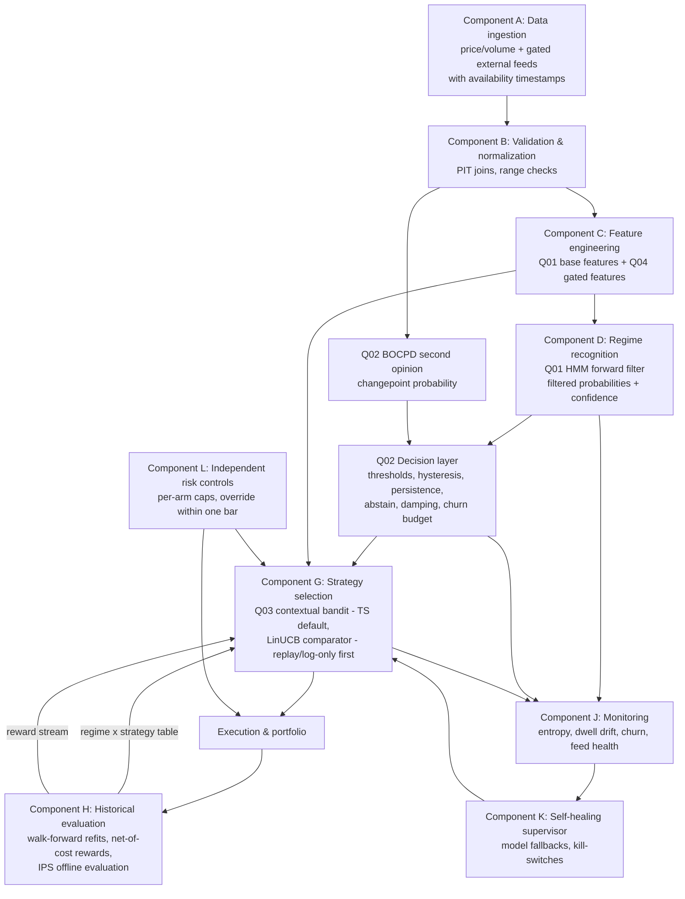

# Gate 1 Market Intelligence Integration Review

This gate integrates the four Market Regimes research records ([[Q01 HMM Market Regimes]], [[Q02 Bayesian Regime Detection]], [[Q03 Contextual Bandit Strategy Selection]], [[Q04 Additional Market Data Sources]]) into a single coherent architecture for how the bot classifies markets and selects strategies, resolves conflicts between the records, and states what must be validated locally before implementation. It prevents piecemeal adoption of the four techniques in incompatible ways, and enforces the ordering that reliable historical evaluation precedes complex selection.

## Scope

The gate covers the plan deliverables for this domain: the proposed market-regime recognition architecture (Q01's causal-filtered HMM); the candidate market features (Q04's gated source families); regime confidence handling (Q02's thresholds, hysteresis, and abstain logic); the strategy-selection methodology (Q03's contextual bandit with Thompson Sampling default and LinUCB comparator); the candidate strategy evaluation process (Q01-B's regime×strategy tables plus Q03-B's offline IPS evaluation); the additional-data requirements (Q04-A, asset-class conditional); the identified algorithm limitations (per record); how market classification and strategy selection interact; and the plan's explicit warning that complex selection must not be implemented before reliable historical evaluation exists — which this gate converts into a hard ordering of deliverables.

## Individual question conclusions

- **Q01-A:** Use a Gaussian HMM on point-in-time features (volatility, momentum, volume, correlations) with walk-forward refits and trailing-window normalization; only forward-filtered probabilities `P(z_t | o_1:t)` may reach the decision path — smoothing and Viterbi are dashboard-only.
- **Q01-B:** Learn regime×strategy performance as a table on training folds with soft probability weighting; trust a ranking only if it persists across walk-forward folds with adequate per-regime sample sizes.
- **Q02-A:** "Genuine change" is a decision-layer event, not a filter crossing: calibrate confidence thresholds on retrospective truth, and treat BOCPD's changepoint probability as a second-opinion/monitoring signal, not a second switch.
- **Q02-B:** Prevent thrashing mechanically — hysteresis band, minimum persistence, switching-cost-aware decisions, abstain zones, and fractional/damped allocation; churn is a monitored, budgeted quantity.
- **Q03-A:** The selection problem maps onto a contextual bandit; use Thompson Sampling as default policy and LinUCB as comparator, with one shared reward function (forward return, net of costs, risk-adjusted, credited at horizon completion).
- **Q03-B:** Explore safely: posterior-sampling exploration under budget caps, no-exploration zones in stress contexts, kill-switch fallback, and mandatory propensity logging so all policy comparisons happen offline via IPS before live use.
- **Q04-A:** Adopt gated, asset-class-conditional sources: daily liquidity estimators and (where an options market exists) implied volatility first; breadth/correlation features next; order-book signals only if intraday data is acquired; every external feed joins point-in-time via availability timestamps.
- **Q04-B:** No feature enters the classifier without per-fold screening (MI, permutation importance) plus seeded ablation showing consistent held-out improvement in regime quality without degrading dwell stability.

## How the techniques interact

The pipeline is layered by evidence → stability → selection. Q01 produces causal filtered regime probabilities (evidence). Q02 converts those probabilities into stable executable states, abstain zones, and damped actions (stability), and its churn control is what makes Q03's learning possible: a bandit cannot learn rewards if its context thrashes. Q03 consumes the stabilized probabilities and entropy as context and picks the strategy arm; its reward stream feeds back into both Q01-B's regime×strategy table and its own posteriors. Q04 enriches the evidence layer: gated features raise the classifier's confidence (lower entropy) and widen the context, but never bypass the gate. Evaluation (H) is the hub: it replays every layer walk-forward, and its net-of-cost accounting is the single definition of reward used by Q01-B and Q03-A. Confidence handling is deliberately split: the HMM's posterior confidence describes the market; the bandit's posterior uncertainty describes the strategies; Q02's thresholds govern transitions between the two layers. Risk controls (L) sit outside the entire pipeline and can override everything within one bar.

## Conflicts and resolutions

1. **Filtered vs smoothed regime labels.** Practitioner pipelines commonly label history with Viterbi/smoothing and backtest on it; theory says that is look-ahead. Resolution: two explicitly separated output columns (`_filtered` for decisions, `_smoothed`/`_viterbi` for dashboards) plus a truncation leakage test in CI.
2. **Classifier sensitivity vs decision stability.** Q01's filter reacts to every observation; Q02's hysteresis buys stability with detection delay. Resolution: stability lives in the decision layer with calibrated delay/false-switch curves; the classifier stays sensitive, and component L's risk limits act inside one bar when delay is dangerous.
3. **Thompson Sampling vs LinUCB.** TS empirically dominates and tunes easily (Chapelle & Li 2011); LinUCB has cleaner analytic confidence (Li et al. 2010). Resolution: TS default, LinUCB comparator; the tie is broken by offline IPS comparison on logged data, not by preference.
4. **More features vs overfitting (Q04-A vs Q04-B).** Forward-looking sources promise lead time but each feature multiplies emission parameters. Resolution: no source enters the classifier without the ablation gate; parsimony budget is recorded and enforced.
5. **Complex selection vs the plan's warning.** A contextual bandit is exactly the "complex selection" the plan forbids before reliable historical evaluation. Resolution: hard ordering — instrumentation/logging first, offline IPS evaluation second, replay in H third, bounded live exploration only after all three pass; until then the selector runs in replay/log-only mode.

## Domain architecture

## Cross-domain dependencies

- [[Q01 HMM Market Regimes]] — producer of the only causal regime probabilities; owner of the walk-forward refit contract.
- [[Q02 Bayesian Regime Detection]] — owner of the decision layer and churn budget; consumes Q01 outputs exclusively.
- [[Q03 Contextual Bandit Strategy Selection]] — consumer of stabilized context and net-of-cost rewards; owner of the propensity log.
- [[Q04 Additional Market Data Sources]] — owner of the feature gate and feed-health requirements; conditions D and G's inputs.
- [[Q06 Time Series Validation]] — the walk-forward/purged-split standards that every evaluation in this gate must follow.
- [[Q09 Point in Time Features]] — the PIT construction and availability-timestamp standards underpinning Q01's features, Q04's joins, and Q03's context.

## Consolidated recommendations

1. **P0 — Leakage discipline (all records).** Truncation leakage tests for features, normalization, regime probabilities, and bandit context; separate `_filtered` vs `_smoothed` outputs; PIT as-of joins with availability timestamps for every external feed.
2. **P0 — Instrument before automating.** Propensity logging of the current selection policy and a single shared net-of-cost reward function; without the log, no offline evaluation is ever possible.
3. **P0 — Walk-forward everything.** HMM refits, threshold calibration, feature gates, and policy comparisons run only on walk-forward folds per [[Q06 Time Series Validation]].
4. **P1 — Decision layer with calibrated parameters.** Hysteresis + minimum persistence + switching-cost rule + abstain zones; calibration artifacts (delay/false-switch curves) stored in component I.
5. **P1 — Feature gate as a standing job.** Per-fold MI/permutation screening plus seeded ablation; accept only consistent cross-fold improvements; parsimony budget recorded.
6. **P1 — Bandit policies behind one interface.** TS default, LinUCB comparator, offline IPS with variance diagnostics deciding; exploration budget caps and stress-context no-exploration zones enforced in code.
7. **P2 — Monitoring and second opinions.** Entropy/dwell/churn/feed-health metrics; BOCPD behind a feature flag as a changepoint monitor; sticky-transition classifier research as a lead.

## Local validation requirements before implementation

- Audit results for the five blocked sections (existing capability, assessment classifications, configuration surfaces) filed against each record.
- Baseline measurements taken before thresholds are chosen: median dwell time, realized switch frequency, per-regime sample counts, refit runtime, feed latency — these define the acceptance baselines referenced by the records.
- Reproducibility: every classifier, threshold, and policy configuration hash-versioned in component I; a full pipeline rerun from a fixed seed reproduces the recorded labels and selections.
- Evaluation integrity: component H demonstrably refits models inside the simulation loop and computes rewards net of costs; the IPS log passes a completeness/schema test.
- Asset-universe confirmation: the Q04 conditionality resolved into a concrete source list for the project's actual assets before any external feed is purchased or integrated.

## Related notes

- [[Q01 HMM Market Regimes]]
- [[Q02 Bayesian Regime Detection]]
- [[Q03 Contextual Bandit Strategy Selection]]
- [[Q04 Additional Market Data Sources]]
- [[Q06 Time Series Validation]]
- [[Q09 Point in Time Features]]
