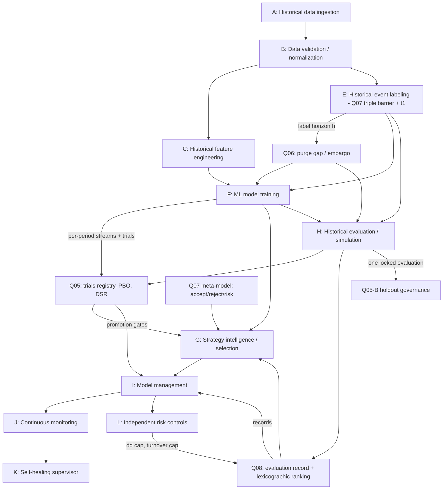

# Gate 2 Historical Training Integration Review

This gate consolidates the four Historical Training research records (Q05 backtest overfitting, Q06 time series validation, Q07 triple barrier and meta labeling, Q08 financial ML evaluation) into a single architecture decision for the ML trading bot's historical pipeline. Its purpose is to verify that the four records form one coherent, leak-free, statistically honest chain — from raw bars to promoted strategies — to surface conflicts between them and resolve them explicitly, and to state what must be validated locally before any implementation begins, since the external repository is not available in this sandbox.

## Scope

The plan deliverables covered by this gate, as quoted from the plan: a **chronological validation architecture** (Q06: every model trained on the past and evaluated only on the future); **overfitting prevention** (Q05: PBO/DSR measurement and control for continuous trial generation); **historical event-labeling methodology** (Q07: triple barrier labels with volatility-adjusted barriers and meta-labeling); **training and validation separation** (Q05-B's holdout governance enforced on top of Q06's chronological splits); a **statistical evaluation framework** (Q08-A: ML metrics with proper scoring rules, non-IID Sharpe corrections, PSR/DSR); a **financial evaluation framework** (Q08: net-of-cost PnL metrics, drawdown, profit factor, turnover, regime-conditional reporting); and the overarching question of **how the system can establish that learned relationships are reproducible rather than historical coincidences** — answered by the combination: honest folds (Q06) produce honest performance streams, whose selection risk is measured (Q05), whose labels reflect real trade outcomes (Q07), and whose significance and ranking are statistically defensible (Q08). A relationship is deemed reproducible only when it passes all four gates simultaneously on untouched data.

## Individual question conclusions

- **Q05-A**: Measure overfitting with CSCV/PBO over the trials registry's per-period return streams; gate promotion on PBO ≤ threshold and DSR ≥ target. [ESTABLISHED]
- **Q05-B**: Enforce a three-segment chronology (train/validation/locked test) with an append-only trials registry, one evaluation per family per generation, and a re-baselining rule after the locked set is consumed. [INTERPRETATION on governance; established motivation]
- **Q06-A**: Walk-forward with purge/embargo is the mandatory primitive; purged K-fold for search loops; plain k-fold only with a residual-autocorrelation pass (Bergmeir & Benítez condition). [ESTABLISHED]
- **Q06-B**: Window lengths and gaps are derived per timeframe from label horizon h, regime duration, learning curves, and significance needs — no universal constants. [INTERPRETATION, established anchors]
- **Q07-A**: Triple barrier labeling with ex-ante volatility-scaled barriers, event-based generation, t₁ persistence, and uniqueness weights. [ESTABLISHED]
- **Q07-B**: Two-stage stack: primary side + calibrated meta-model emitting accept/reject/risk level; documented OOS improvements on E-mini data, with effect sizes dependent on primary quality. [ESTABLISHED for method and cited results]
- **Q08-A**: Fixed evaluation record (ML block with Brier/log-loss/calibration; net-of-cost PnL block; regime block; metadata) keeps accuracy and PnL separate; Sharpe requires PSR/DSR corrections. [ESTABLISHED]
- **Q08-B**: Lexicographic ranking — risk constraints (component L) first, then statistical significance (PSR/DSR), then net PSR, then worst-regime Sharpe and consistency tie-breakers; composite scores reporting-only. [INTERPRETATION]

## How the techniques interact

The chain is strictly sequential in data flow and circular in feedback. Q07's labeling defines the label horizon h and event intervals that parameterize Q06's purge gap and embargo; Q06's leak-free folds produce the per-period return streams and fold-level scores; Q05's CSCV/DSR consume those streams to quantify selection risk over the whole trial population; Q08's evaluation record aggregates everything into the metrics that feed Q05's thresholds back into promotion. The locked holdout of Q05-B is the final arbiter evaluated once, under Q06's chronology, with Q08's full record — so no single record's guarantees stand alone.

## Conflicts and resolutions

1. **Bergmeir & Benítez vs López de Prado on k-fold CV**: not a contradiction — the former's validity condition (uncorrelated errors) fails for overlapping financial labels; resolution: purge/embargo mandatory for financial labels, plain k-fold only after a residual-autocorrelation test passes.
2. **AFML chapter numbering**: the task lead cited "ch. 11" for backtest statistics; the verified Wiley TOC places Backtest Statistics at ch. 14 (pp. 195–207). Records cite ch. 14; ch. 11 was not separately verified.
3. **DSR vs Harvey–Liu haircuts**: different inputs and philosophies (expected-max-Sharpe vs multiple-testing thresholds); resolution: DSR primary, haircuts/Reality Check as P2 cross-check when they disagree.
4. **Timeout labels in triple barrier**: AFML's canonical sign-of-return vs implementations using neutral/excluded timeouts; resolution: sign convention for 3-class use, non-win (0) for meta-labeling, fixed once in config.
5. **Composite scores vs lexicographic ranking (Q08-B)**: composite hides trade-offs; lexicographic is coarser; resolution: lexicographic decides, composite is reported for humans only.
6. **Trial counting for DSR**: raw grid entries overstate N; deduplication is judgment-dependent; resolution: log both, use the conservative (larger) effective N.

## Domain architecture

## Cross-domain dependencies

- [[Q07 Triple Barrier and Meta Labeling]] ↔ [[Q06 Time Series Validation]]: t₁/label horizon sizes the purge gap and embargo; event labels require interval-intersection purging.
- [[Q05 Backtest Overfitting]] ↔ [[Q06 Time Series Validation]]: CSCV/DSR inputs must come from purged folds or the corrections inherit leakage bias.
- [[Q05 Backtest Overfitting]] ↔ [[Q08 Financial ML Evaluation]]: N and SR₀ turn PSR into DSR; Q08's significance layer depends on the trials registry.
- [[Q08 Financial ML Evaluation]] ↔ [[Q07 Triple Barrier and Meta Labeling]]: meta-model probabilities must be calibrated (Brier/reliability) before bet sizing is meaningful.
- All four ↔ [[Gate 2 Historical Training]]: this gate verifies the chain end-to-end.
- Adjacent categories (referenced, not owned): component D's regime labels feed Q06-B window derivation and Q08's regime block; component L owns Q08's constraint values; component J reuses Q08's metric module for live drift detection.

## Consolidated recommendations

- **P0**: single purge/embargo walk-forward splitter as the only CV primitive (Q06); trials registry with per-period streams written at trial time (Q05); triple-barrier labeling with ex-ante volatility and t₁ persistence (Q07); net-of-cost PnL metrics and PSR in one shared evaluation-record module (Q08).
- **P0**: promotion gates wired end-to-end: PBO ≤ threshold, DSR ≥ target, calibrated meta-model, one locked-holdout evaluation per candidate.
- **P1**: uniqueness sample weights and imbalance handling (Q07); meta-labeling stack with frozen probability thresholds (Q07); label/simulation agreement tests (Q07↔H); window-derivation job producing signed w/t/g/e per timeframe (Q06-B); fold-metadata persistence (Q06→Q05); lexicographic ranking with layer-labeled decisions and constraint values owned by component L (Q08); regime-conditional metric block (Q08).
- **P2**: White/Harvey–Liu cross-checks when PBO and DSR disagree (Q05); Ljung–Box gate for any k-fold exception (Q06); barrier multipliers as logged hyper-parameters (Q07); paired-bootstrap difference testing and churn protection for near-ties (Q08).

## Local validation requirements before implementation

1. Run the BLOCKED audit checklists in all four records and record classifications (IMPLEMENTED AND VERIFIED … BLOCKED BY A DEPENDENCY) per component.
2. Pin library versions: sklearn (gap exists since v0.24), and confirm availability/licensing of mlfinlab or equivalent labeling libraries.
3. Verify archive quality prerequisites: bar continuity for equal-spacing assumptions (component B), sufficient history length ≥ w + k(t+e) for the derived windows.
4. Data-availability check for the CSCV input matrix: per-period return streams must be retrievable for ≥ 100 historical trials before DSR/PBO are meaningful.
5. Confirm component D's regime labels exist for the historical span (regime blocks and window derivation depend on them).
6. Establish baselines before thresholds: first registry cycle for PBO/DSR distributions, first labeling run for coverage/uniqueness, first evaluation cycle for threshold selection (all acceptance criteria in the four records state their baseline procedure).
7. Reproduce one verification: recompute PSR and Brier on fixtures against sklearn references to pin metric conventions (kurtosis definition especially).

## Related notes

- [[Q05 Backtest Overfitting]]
- [[Q06 Time Series Validation]]
- [[Q07 Triple Barrier and Meta Labeling]]
- [[Q08 Financial ML Evaluation]]
