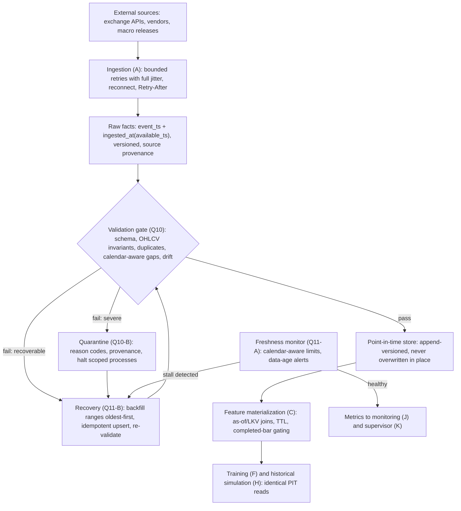

# Gate 3 Data Integrity Integration Review

This gate integrates the three Data Integrity research records — [[Q09 Point in Time Features]], [[Q10 Historical Data Validation]], and [[Q11 Data Freshness and Recovery]] — into one coherent architecture for how market and external data enters, is checked, is repaired, and is consumed by the ML trading pipeline. Its purpose is to resolve interactions and tensions among the three records before implementation, consolidate their recommendations into one deduplicated backlog, and state what must be validated locally before implementation starts. The external repository is not available in this sandbox, so integration claims here are design commitments pending the local audits in the individual records.

## Scope

The Data Integrity plan deliverables this gate covers, as stated by the plan:

- **Historical data quality architecture** — the end-to-end structure of ingestion, validation, quarantine, and recovery (Q10-B, Q11-B).
- **Point-in-time feature reconstruction** — every training example contains only information available at its decision moment (Q09-A, Q09-B).
- **Data validation rules** — the codified rule catalog for missing candles, duplicates, invalid prices, unusual volume, inconsistent timestamps, and structure changes (Q10-A).
- **Data freshness monitoring** — per-(venue, symbol, timeframe) staleness thresholds and silent-stall detection (Q11-A).
- **Data recovery process** — bounded jittered retries, reconnection, calendar-driven backfill, idempotent upserts, verification (Q11-B).
- **Dataset quarantine and reconciliation** — isolated storage of suspect records with reason codes, re-validation, and source reconciliation (Q10-B, Q11-B).

And the plan's governing rule that **invalid data must never silently enter the training pipeline** — operationalized here as: a blocking validation gate in front of the feature store, quarantine (never silent drop) for failures, severity-tiered halting of affected downstream processes, and versioned (non-overwriting) corrections.

## Individual question conclusions

- **Q09-A**: Two-timestamp schema with an as-of LKV join, TTL, and availability-time filtering is the only sanctioned way to build training rows; Feast's docs show the default join leaks backfilled/corrected values. [ESTABLISHED]
- **Q09-B**: Multi-source sync requires UTC/epoch normalization, per-venue bar conventions, per-source publication-delay models (vintages for macro, e.g., ALFRED), completed-bar gating, and append-versioned corrections. [ESTABLISHED core; per-venue conventions outstanding]
- **Q10-A**: A rule catalog (OHLC invariants, positivity/finiteness, duplicate keys, calendar-aware gaps, monotonic/future timestamps, schema/drift) runs as a blocking gate with reason codes; pandas/pandera for predicates, GX/TFDV-style statistics for distribution/skew. [ESTABLISHED tooling; thresholds INTERPRETATION]
- **Q10-B**: Severity-tiered policy — S1 log+backfill, S2 bounded recovery then quarantine, S3 quarantine+halt affected training, S4 quarantine+halt ingestion; fail-safe default is quarantine + halt, never silent imputation. [INTERPRETATION, operationalizing the plan rule]
- **Q11-A**: Freshness = age of newest event timestamp vs `K × bar_period + ingest_buffer`, evaluated only during open sessions, with consecutive-miss escalation and symbol-vs-venue stall classification; data age, not process health, is authoritative. [ESTABLISHED primitives; formula INTERPRETATION]
- **Q11-B**: Recovery = classify failure → bounded full-jitter backoff (AWS/Brooker) → breaker and escalation → reconnect with snapshot reconciliation → calendar-driven oldest-first backfill via atomic idempotent upserts (PostgreSQL ON CONFLICT) → mandatory re-validation and reconciliation. [ESTABLISHED primitives; loop design INTERPRETATION]

## How the techniques interact

The three records form one data path with distinct responsibilities. Q09 defines the **read model**: facts carry both when they happened and when they became known, and features are materialized only through as-of joins onto decision grids. Q10 defines the **admission model**: nothing reaches the PIT store or training without passing the validation gate, and failures are quarantined with reason codes. Q11 defines the **currency model**: freshness monitoring decides when data should have arrived and triggers recovery, while recovery writes back through idempotent upserts that must then re-pass the Q10 gate. The coupling points are explicit: Q10 validates the timestamp fields Q09's joins depend on; Q11's `ingested_at` is Q09's `available_ts` and must survive recovery; Q10's severity tiers gate Q11's automated recovery; Q11's calendar module is shared with Q10's gap detection. A failure of any one invalidates the others' guarantees — hence one gate.

## Conflicts and resolutions

1. **Imputation convenience vs leakage prevention.** Filling missing bars is tempting for feature continuity, but fabricated prices are lookahead-adjacent fictions. *Resolution*: fills are permitted only if flagged, never used for labels, and visible to monitoring; the default for missing price data is recovery, not imputation.
2. **Current-corrected data vs data-as-known-then.** Research wants today's revised series; training requires the vintage view. *Resolution*: dual reads — append-versioned store serves both (vintage read for training, current read for research), following the Feast `created_timestamp` lesson and ALFRED's vintage model.
3. **Recovery overwrites vs version preservation.** An idempotent upsert that restates history conflicts with Q09's requirement that corrections stay point-in-time separable. *Resolution*: conflict handlers append new version rows rather than mutating old ones; plain upserts are allowed only for rows that never existed.
4. **Strict validation vs data starvation.** Over-strict thresholds quarantine legitimate data (holidays, illiquid zero-volume bars). *Resolution*: baseline-first calibration — measure false-quarantine rates per venue and rule for ≥ 90 days before tightening, and version the rule catalog so threshold changes are auditable.
5. **Process-health alerting vs data-age alerting.** Process metrics are cheap but blind to silent stalls. *Resolution*: both are kept, but only the data-age (freshness) check may declare staleness; process metrics feed component health instead.

## Domain architecture

The flow enforces the plan rule structurally: the only path from sources to training data passes the validation gate; quarantine and recovery both re-enter the gate; the freshness monitor closes the loop by detecting silent stalls and triggering recovery.

## Cross-domain dependencies

- [[Q17 Reproducibility and Versioning]] — dataset versions, rule-catalog versions, threshold configs, and feature-definition versions must be pinned so validation verdicts and PIT reads are reproducible.
- [[Q21 Component Health Monitoring]] — freshness metrics, quarantine rates, retry/circuit-breaker states, and gate outcomes are health signals for components J/K; data-age alerts escalate through the same alerting ladder.
- Within this category: [[Q09 Point in Time Features]] (read model), [[Q10 Historical Data Validation]] (admission model), [[Q11 Data Freshness and Recovery]] (currency model).
- Plan components touched: A, B, C, D, E, F, G, H, I, J, K, L (see each record's "Application to this project").

## Consolidated recommendations

- **P0 (do first, blocking):** (1) two-timestamp schema — every fact stores `event_ts` and `available_ts`, with `available_ts >= event_ts` enforced at write (Q09/Q10); (2) blocking validation gate with the six-class rule catalog and reason codes in front of the feature store and training inputs (Q10); (3) quarantine store with provenance, re-validation readmission, and fail-safe halting (Q10-B); (4) idempotent upserts keyed on (symbol, event_ts, timeframe) for all ingestion and recovery writes (Q11); (5) bounded retries with exponential backoff + full jitter, Retry-After compliance, and circuit breakers (Q11); (6) calendar-aware freshness thresholds per (venue, timeframe), baselined before enforcement (Q11).
- **P1:** vintage/append-versioned corrections with dual reads (Q09); completed-bar gating for multi-timeframe features with tests (Q09); automated calendar-driven backfill with reconciliation reports (Q11); purge/embargo in walk-forward CV (Q09); distribution-drift monitoring with measured baselines (Q10); stream reconnect with snapshot reconciliation and group-level stall classification (Q11).
- **P2:** training/serving parity tests (Q09); pandera/GX adoption for managed expectations and DataDocs, TFDV-style statistics if scale warrants (Q10); secondary-vendor reconciliation and periodic cross-source spot checks (Q10/Q11); schema-migration path with feature-cache invalidation (Q10).

## Local validation requirements before implementation

1. Run all three BLOCKED audit checklists in [[Q09 Point in Time Features]], [[Q10 Historical Data Validation]], [[Q11 Data Freshness and Recovery]] against the repository; record classifications per the shared vocabulary.
2. Establish baselines: arrival-latency distributions (p99 per source), false-quarantine rates per rule over ≥ 90 days, and current leakage-violation count (`available_ts > decision_ts` in existing training data).
3. Verify per-venue facts before coding: bar timestamp conventions (open vs close labeling), correction/restatement behavior, rate limits, reconnection semantics, and whether calendars exist for every venue traded (custom calendars for 24/7 venues).
4. Prove storage capability for the P0 writes: unique constraints on (symbol, event_ts, timeframe) and upsert/versioning behavior match the intended conflict handling.
5. Fault-inject before go-live: seeded corruption (Q10), induced stalls (Q11), duplicate-prone retry storms (idempotency proof), and a leakage regression test (Q09) in CI.

## Related notes

[[Q09 Point in Time Features]] · [[Q10 Historical Data Validation]] · [[Q11 Data Freshness and Recovery]] · [[Q17 Reproducibility and Versioning]] · [[Q21 Component Health Monitoring]]
