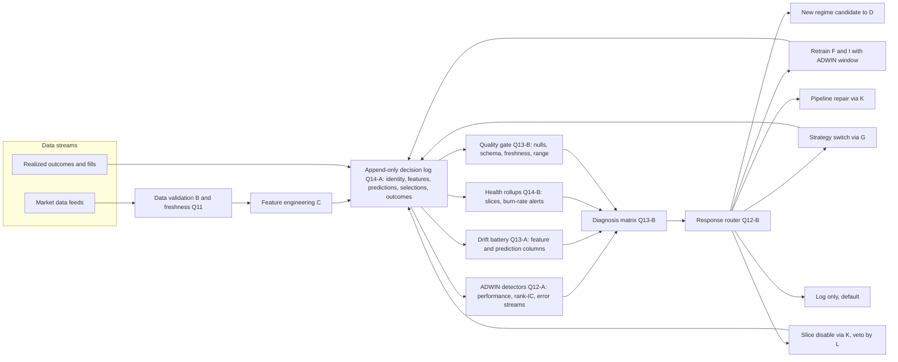

# Gate 4 Continuous Learning Integration Review

This gate closes the Concept Drift research cycle (Q12–Q14) by checking that the three records form one coherent continuous-learning architecture rather than three parallel techniques. Its purpose is to verify that the domain's planned deliverables — a drift detection architecture, monitoring metrics, model health profiles, retraining triggers, model degradation diagnosis, strategy isolation rules, and the plan's explicit goal of detecting changing conditions *without* constantly retraining or replacing models unnecessarily — are each covered by at least one record, that the records' inputs and outputs chain correctly (Q14's log feeds Q12's detectors, Q12's alarms feed Q13's diagnosis, Q13's verdicts feed the response router), and that recorded conflicts between techniques have explicit resolutions. All three records are RESEARCH COMPLETE with implementation pending local audit; this gate likewise carries no implementation claim.

## Scope

The gate reviews the plan deliverables, quoted from the research plan, against the records:

- **Drift detection architecture** — [[Q12 ADWIN Concept Drift]] (Q12-A: ADWIN/ADWIN2 detectors on per-strategy performance, per-feature rank-IC, and per-model error streams, with river's documented parameters and δ budgeting).
- **Monitoring metrics** — [[Q13 Drift Diagnosis]] (Q13-A: feature/prediction drift batteries — KS, PSI, Jensen–Shannon, normalized Wasserstein — plus quality-gate metrics) and [[Q14 Per Component Model Monitoring]] (Q14-B: per-slice win rate, edge, Sharpe, calibration, quality-pass rate).
- **Model health profiles** — Q14 (per-model-version health-profile contract, the model-card operational twin, per-slice floors with minimum evidence).
- **Retraining triggers** — Q12 (confirmed global drift, ADWIN-surviving window as retraining corpus) and Q13 (only a persisted CONCEPT_DRIFT verdict may trigger retraining).
- **Model degradation diagnosis** — Q13 (quality-first decision matrix classifying benign shift, concept drift, target drift, pipeline failure).
- **Strategy isolation rules** — Q14 (isolation ladder: slice-disable → strategy-pause → risk-control-only system halt, with sibling-health preconditions and multiwindow confirmation).
- **Detect changing conditions without constantly retraining or replacing models unnecessarily** — the shared constraint enforced by two-stage confirmation (Q12), the performance-degradation requirement inside the diagnosis matrix (Q13), and minimum-evidence gating (Q14); "log only" is the default verdict when evidence is incomplete.

## Individual question conclusions

- **Q12-A:** ADWIN (river ADWIN2: delta=0.002, clock=32, max_buckets=5, min_window_length=5, grace_period=10) gives a formally bounded false-alarm rate and a retained retraining window; point-in-time safe by construction. Monitor relationship-level statistics (rank IC, win rate), not raw equity.
- **Q12-B:** Map severity × scope × persistence × quality-gate to retrain / new regime / switch / disable; no destructive action on a single alarm — confirmation window or second-detector agreement, and consult the regime detector before registering new regimes.
- **Q13-A:** Feature and prediction drift as independent per-column batteries: KS small-sample, normalized Wasserstein/Jensen–Shannon large-sample (documented defaults), PSI reporting-only; effect-size thresholds calibrated by replay, never p-values alone.
- **Q13-B:** Quality gate first (drift tooling filters nulls/infinities and is blind to pipeline failures), then quality × feature-drift × prediction-drift × performance matrix → BENIGN_SHIFT / CONCEPT_DRIFT / TARGET_DRIFT / PIPELINE_FAILURE; only CONCEPT_DRIFT authorizes retrain/replace.
- **Q14-A:** Append-only decision log with five field groups (identity, processing, decision, outcome, context); decision rows never sampled, never mutated; two-tier retention plus a completeness monitor.
- **Q14-B:** Per-slice health rollups with minimum evidence (advisory ≥30, isolation ≥100), short+long-window burn-rate confirmation, isolation ladder with sibling-health checks and a risk-control-owned halt.

## How the techniques interact

The three records form a pipeline, not a menu. Q14's decision log is the substrate: it provides the joined columns (features, predictions, outcomes, quality flags, regime labels) from which Q12's monitored streams are derived and Q13's reference/detection windows are cut. Q12 is the *fast online layer*: continuous alarms with severity and scope. Q13 is the *diagnosis layer*: its quality gate and matrix consume the alarm plus logged evidence to produce a verdict class. Q14-B's rollups are the *slow aggregate layer*: they confirm or contradict point alarms with slice-level performance over short and long windows. The response router (Q12-B) is the single consumer of verdicts: retrain requests go to F/I with the ADWIN window; regime candidates go to D; switch proposals go to G; repairs go to K; disables go through K with L's veto. Every action writes back to the log, closing the loop.

## Conflicts and resolutions

1. **Sensitivity vs stability.** Fast detection (larger δ, shorter windows) conflicts with avoiding unnecessary retraining. Resolution: two-stage confirmation (alarm persists or a second detector agrees) plus system-level δ budgeting; default verdict "log only".
2. **Vendor defaults vs classical conventions.** Evidently's large-sample defaults (Wasserstein/JS, 0.1 distance) conflict with credit-scoring PSI-band practice. Resolution: PSI demoted to reporting with versioned binning; automated gating uses replay-calibrated effect-size thresholds.
3. **Regime attribution overlap.** A performance-drift alarm may be caused by a regime flip component D already models. Resolution: the router queries D before registering new regimes; BENIGN_SHIFT/TARGET_DRIFT verdicts are regime-candidate inputs; disagreements are logged as evidence, not silently double-registered.
4. **Slice-level noise vs global alarms.** Q14's many slices and Q12's many detectors multiply false alarms. Resolution: minimum-evidence gating per slice and multiwindow burn-rate confirmation before isolation; Q12 monitors derived statistics rather than raw equity.
5. **Confirmation delay vs catastrophic failure.** Confirmation windows delay action on a truly broken component. Resolution: catastrophic criteria (total drawdown, data-integrity compromise) remain permanently assigned to L, which acts at global scope while K's automated ladder stays conservative.

## Domain architecture

## Cross-domain dependencies

- [[Q02 Bayesian Regime Detection]] — the regime axis of every slice and the cause-attribution check the router consults before registering new regimes (Q12-B, Q13-B).
- [[Q15 Continuous ML Pipeline]] — executes retraining requests; consumes the ADWIN-surviving window and writes new model versions that open new slice lineages (Q12-B, Q14-A).
- [[Q11 Data Freshness and Recovery]] — the freshness checks inside Q13-B's quality gate and detector-starvation protection for Q12 (a stopped feed must never masquerade as drift).
- Intra-domain: [[Q12 ADWIN Concept Drift]], [[Q13 Drift Diagnosis]], [[Q14 Per Component Model Monitoring]]; storage of health profiles joins the model-management capabilities audited under component I.

## Consolidated recommendations

1. **P0 — Decision log first (Q14-A):** append-only schema, five field groups, synchronous writes, never-sampled decision rows, plus the completeness monitor; everything else is unimplementable without it.
2. **P0 — Quality gate before any drift signal (Q13-B):** null share, schema, freshness, range; gate failure blocks all drift-based responses and routes to repair.
3. **P0 — ADWIN detectors on the three statistic families (Q12-A)** with river's documented defaults, one instance per Q14 slice.
4. **P0 — Two-stage confirmation on every destructive action (Q12-B/Q13-B/Q14-B):** confirmation window or second-detector agreement; "log only" default.
5. **P1 — Diagnosis matrix as code (Q13-B):** one verdict per run with an evidence trace; only CONCEPT_DRIFT authorizes retrain/replace.
6. **P1 — Calibrate thresholds by local replay (Q12, Q13):** per-feature effect-size thresholds and per-detector δ budgets from measured null distributions; no invented absolutes.
7. **P1 — Isolation ladder with sibling-health checks and multiwindow burn-rate confirmation (Q14-B);** system halt owned by L alone; retrain from the ADWIN window with boundaries recorded in the registry (I); publish per-model health profiles at deploy.
8. **P2 — Benchmark ADWIN vs Page-Hinkley vs DDM on replayed history;** version PSI binning; add one multivariate correlation-drift proxy; cluster recurring cuts into regime candidates; keep rollups recomputable from the immutable log.

## Local validation requirements before implementation

1. Complete the three records' BLOCKED audit checklists against the local repository and classify each record with the agreed vocabulary (IMPLEMENTED AND VERIFIED / IMPLEMENTED BUT INCOMPLETE / IMPLEMENTED BUT UNVERIFIED / PARTIALLY IMPLEMENTED / MISSING / INCORRECT OR UNSAFE / NOT APPLICABLE / BLOCKED BY A DEPENDENCY).
2. Establish baselines before thresholds: replay history through the detectors and batteries to measure delay, false-alarm rates, and per-statistic null distributions; every downstream threshold must cite these measured baselines.
3. Verify the decision log's join integrity and completeness on real data before trusting any rollup.
4. Reconcile existing regime labels (D) with historical ADWIN cut points to confirm or reject the cause-attribution assumption.
5. Confirm the enable/disable surface supports slice-level actions and that L's global halt is independent of the automated ladder.
6. Do not begin implementation until items 1–5 are recorded; this gate's status remains DOCUMENT FOR FUTURE USE until then.

## Related notes

- [[Q12 ADWIN Concept Drift]]
- [[Q13 Drift Diagnosis]]
- [[Q14 Per Component Model Monitoring]]
- [[Q02 Bayesian Regime Detection]]
- [[Q15 Continuous ML Pipeline]]
- [[Q11 Data Freshness and Recovery]]
